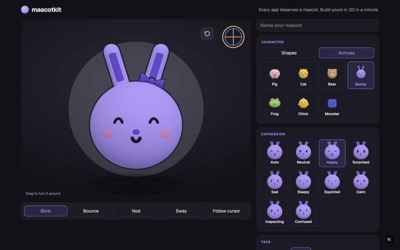

<h1 align="center">mascotkit</h1>

<p align="center"><b>Every app deserves a mascot.</b> Build a cute 3D one for yours in about a minute.</p>

<p align="center">
  <a href="LICENSE"></a>
  
  
  
  <a href="https://github.com/AaravKumar11/mascotkit/pulls"></a>
</p>

<p align="center"></p>

mascotkit is a small, open-source studio for building a cute mascot for your app in about a minute. Pick a 3D shape or animal, give it a mood, make it blink, bounce or nod, then export it as PNG, a 3D model or a React component.

## Features

- **Real 3D characters** built with Three.js. Drag to turn them around, and the face wraps around the curve of the head.
- **12 shapes:** blob, sphere, cube, pill, triangle, egg, drop, cloud, ghost, sun, lamp, gold coin
- **7 animals:** pig, cat, bear, bunny, frog, chick, monster
- **9 expressions plus Auto:** neutral, happy, surprised, sad, sleepy, squinted, calm, inspecting, confused. Switching expressions morphs the face smoothly, and Auto cycles through moods on its own.
- **Motion:** blink, bounce, nod, sway and follow-the-cursor, each toggled on and off. No spinning.
- **Face options:** mouth or no mouth, and a nose (button, triangle, snout, muzzle, beak) or none. Shapes start with just eyes.
- **Sliders:** eye height, eye size and eye gap, plus body scale, width, height and depth. Eyes stay round when you stretch the body.
- **Outline:** none, thin or thick cartoon outline
- **Accessories:** sprout, antenna, crown, cap, bow, coin, halo
- **Color:** flat matte finish with true colors and no glare, 16 palettes, or any color you like
- **Exports:** PNG (1024 px), transparent PNG, an expression sheet with every mood, a `.glb` 3D model for Blender, Unity or the web, and a ready-to-paste React snippet
- **Share links:** every design is saved in the URL
- **AI from text (optional):** describe your mascot ("a sleepy purple bunny for a meditation app") and Claude picks the parts and colors

## Quick start

You need Node.js 20.9 or newer.

```bash
git clone https://github.com/AaravKumar11/mascotkit.git
cd mascotkit
npm install
npm run dev
```

Open http://localhost:3000.

### Turn on AI generation (optional)

Everything works without this. To enable the "Describe it" box, copy `.env.example` to `.env.local` and add your Anthropic API key:

```bash
cp .env.example .env.local
```

Generation uses Claude to choose from the same parts you see in the studio, so the result is always a real, editable mascot. Each request costs a fraction of a cent on your own key.

## Use the mascot in your React app

The mascot lives in [`src/mascot`](src/mascot). Copy that folder into your project, install its 3D dependencies, and use it:

```bash
npm install three @react-three/fiber @react-three/drei
```

```tsx
import { Mascot } from './mascot';

<Mascot species="lamp" mood="happy" accessory="crown" blink bounce size={160} />;
```

Use **Copy React** in the studio to get the exact props for your design. Already have a react-three-fiber scene? Use `<MascotModel />` inside your own `<Canvas>` instead.

| Prop | Values | Default |
| --- | --- | --- |
| `species` | shapes: `blob` `sphere` `cube` `pill` `triangle` `egg` `drop` `cloud` `ghost` `sun` `lamp` `coin`; animals: `pig` `cat` `bear` `bunny` `frog` `chick` `monster` | `blob` |
| `mood` | `neutral` `happy` `surprised` `sad` `sleepy` `squinted` `calm` `inspecting` `confused` `auto` | `happy` |
| `accessory` | `none` `sprout` `antenna` `crown` `cap` `bow` `coin` `halo` | `sprout` |
| `background` | `none` `circle` `squircle` | `circle` |
| `color` `accent` `ink` `bgColor` | any `#rrggbb` | mint palette |
| `mouth` `cheeks` | boolean | `false` `false` |
| `nose` | `none` `button` `triangle` `snout` `muzzle` `beak` | `none` |
| `outline` | `none` `thin` `thick` | `none` |
| `scale` | 0.6 to 1.3 | `1` |
| `width` `height` | 0.6 to 1.5 | `1` |
| `depth` | 0.5 to 1.5 | `1` |
| `eyeY` | -0.3 to 0.3 | `0` |
| `eyeSize` | 0.5 to 1.8 | `1` |
| `eyeGap` | 0.5 to 1.6 | `1` |
| `blink` `bounce` `nod` `sway` `follow` | boolean | `false` |
| `size` | number or CSS size | `200` |
| `shadow` | boolean | `true` |

A good pattern is to change `mood` with your app's state: `happy` on success, `sad` on errors, `sleepy` for empty states, `inspecting` while loading.

## Project structure

```
src/
  mascot/            The reusable 3D mascot (copy this into your app)
    Mascot.tsx       Ready-made canvas, lights and shadow
    MascotModel.tsx  The mascot as a scene object, plus motion
    shapes.tsx       Every shape and animal, built from 3D primitives
    face.tsx         Every expression, as small 3D parts on the face
    accessories.tsx  Hats, crowns, sprouts and friends
    surface.ts       Places face parts on curved bodies
    materials.ts     Matte materials (true colors, no glare)
    outline.ts       Cartoon outlines
    config.ts        Types, defaults, palettes, randomizer, input sanitizing
  components/
    Studio.tsx       The editor UI and exports
    Thumb.tsx        Offscreen renderer for the option thumbnails
  app/
    page.tsx         Studio page
    api/generate/    Optional AI endpoint (Claude)
```

## Add your own parts

- **New shape or animal:** add a name to `SHAPES` or `ANIMALS` in `config.ts`, then an entry in `shapes.tsx` with its body, a `surface` describing the front of the face, the face layout and where accessories sit.
- **New expression:** add a name to `MOODS`, then an entry in `EXPRESSIONS` in `face.tsx`.
- **New accessory:** add a name to `ACCESSORIES`, then an entry in `accessories.tsx`.

The studio picks up new parts automatically. Pull requests with new parts are welcome.

## Contributing

Issues and pull requests are welcome. Before opening a PR, make sure these pass:

```bash
npm run lint
npx tsc --noEmit
npm run build
```

## Deploy

It is a standard Next.js app, so it runs anywhere Next.js does. On Vercel, import the repo and optionally add `ANTHROPIC_API_KEY` as an environment variable. If you deploy publicly with a key, add rate limiting to `/api/generate` so strangers cannot run up your bill.

## License

MIT. Mascots you make with mascotkit are yours to use however you like, including commercially.
